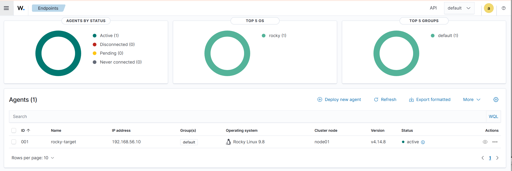

# Linux Hardening & Security Monitoring Lab

A home lab for hardening a Linux server against NIST 800-53 controls, continuously checking that the hardening stays in place, monitoring the system through a SIEM, and documenting what broke along the way.

The goal is to practice the work a security operations team does: enforce a baseline, detect drift from it, collect evidence, monitor events centrally, and root-cause failures instead of guessing.

## Lab setup

| Machine | Role |
| --- | --- |
| Rocky Linux VM | Hardening target (Wazuh agent installed) |
| Ubuntu VM | Ansible control node |
| Wazuh VM | SIEM server: log collection, alerting, dashboard |

All VMs run in VirtualBox on a Windows host, on an isolated lab network.

## What it does

**1. Hardening (`ansible/`).** An Ansible playbook applies 10 NIST 800-53 controls to the target, covering:

* Access control and least privilege
* Identification and authentication
* Audit logging
* Time synchronization
* Least functionality (disabling unneeded services)
* Patching and updates

**2. Drift detection (`drift/`).** A Python checker verifies each control on the live system and reports whether it still passes. Hardening that silently erodes is a real risk, so the checker treats "configured once" and "still configured" as different things.

**3. Evidence (`evidence/`).** Each run writes timestamped JSON results per control, so there is an audit trail of when a control passed or failed.

**4. Metrics (`monitoring/`).** Drift results are exposed as Prometheus metrics, so compliance status can be watched over time instead of checked by hand.

**5. SIEM monitoring (Wazuh).** A dedicated Wazuh server collects logs from the Rocky Linux target through an installed agent, giving a central view of authentication events, system changes, and security alerts. This moves the lab from checking its own configuration to monitoring it the way a SOC would: events flow to a SIEM, get evaluated against rules, and surface as alerts to triage.

**6. Detection tests (`detections/`).** Adversary techniques run deliberately against the lab to validate the pipeline end to end and confirm alerts map to MITRE ATT&CK. First test: SSH brute force (T1110), where Wazuh's level-10 brute-force correlation rule (5712) fired. [Report](detections/2026-10-13-ssh-bruteforce-t1110.md)

## Incident log

Real problems hit while building the lab, each written up with symptoms, investigation, and root cause in the [incident log](docs/incident-log.md). Highlights:

* **[IP address conflict](docs/incident-log.md).** Connectivity was intermittent. Mismatched TTL values in ping replies revealed that two
