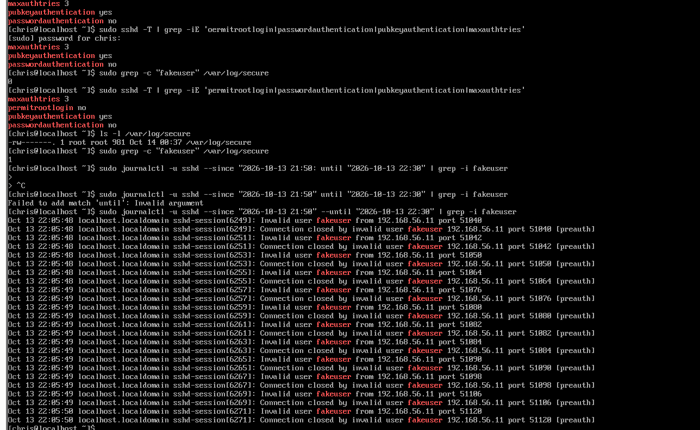
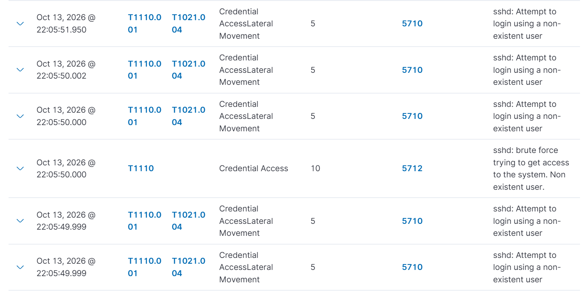

# Detection Test — SSH Brute Force (T1110)

**Date:** 2026-10-13, ~22:05 local
**Objective:** Validate the detection pipeline end to end by generating SSH
brute-force traffic against the hardened Rocky host and confirming Wazuh
detects, correlates, and maps it.

## Environment

| Role | Host | Notes |
|------|------|-------|
| Attacker | Ubuntu server | Source of the SSH attempts |
| Target | Rocky (Wazuh agent, `192.168.56.10`) | Generates sshd events, forwards via agent |
| SIEM | Wazuh manager | Receives, correlates, renders dashboard |

Agent confirmed **Active** in the manager before the test.

## What was run

From the Ubuntu attacker, 12 rapid failed login attempts against a
non-existent user:

```bash
for i in $(seq 1 12); do
  sshpass -p 'wrongpass' ssh -o StrictHostKeyChecking=no \
    -o PubkeyAuthentication=no fakeuser@192.168.56.10 exit
done
```

The attempts were fired in a tight burst (all 12 inside roughly one
30-second window) to cross Wazuh's brute-force correlation threshold, not
just trigger individual failed-login rules.

**Target config at test time** (`sshd -T`): `passwordauthentication no`,
`pubkeyauthentication yes`, `permitrootlogin no`, `maxauthtries 3`.

Because password auth was disabled, no password was ever sent. All 12
attempts were rejected pre-authentication as invalid-user events, and
`MaxAuthTries` never came into play. The burst ran from 22:05:48 to
22:05:50, about two seconds.

**Host-side confirmation.** The events were written to the systemd journal
under `sshd-session`, not to `/var/log/secure`:

    sudo journalctl -u sshd --since "2026-10-13 21:50" --until "2026-10-13 22:30" | grep -i fakeuser

This returned 12 `Invalid user fakeuser from 192.168.56.11` /
`Connection closed by invalid user ... [preauth]` pairs, one per attempt,
matching the 12 events Wazuh received.



## What detected

12 attempts on the host produced 12 Wazuh alerts:

| Rule | Level | Description | MITRE | Count |
| --- | --- | --- | --- | --- |
| 5710 | 5 | sshd: Attempt to login using a non-existent user | T1110.001, T1021.004 | 11 |
| 5712 | 10 | sshd: brute force trying to get access to the system. Non existent user. | T1110 | 1 |

The key result is rule **5712**. It is a frequency-based correlation rule
built on 5710: once enough invalid-user failures arrive from the same
source within its time window, it raises a level-10 brute-force alert. It
fired at 22:05:50, during the burst. A plain log grep would show 12 failures;
the correlation rule is what turns them into one high-severity alert to triage.

**MITRE tactic counts explained.** The dashboard showed Credential Access (12)
and Lateral Movement (11). Rule 5710 maps to both T1110.001 (Password
Guessing) and T1021.004 (SSH), while 5712 maps to T1110 only. The event that
crossed the threshold was raised as 5712 instead of 5710, so Credential
Access counts all 12 alerts and Lateral Movement counts 11. **No lateral
movement occurred.** The T1021.004 tag reflects that SSH is a remote-access
service, not that a pivot happened.

**PCI DSS mappings.** The alerts also mapped to logging requirements
10.2.4, 10.2.5, and 10.6.1, showing failed access attempts were captured
and reviewed centrally.



## Findings

1. Full pipeline validated: attacker → target sshd → agent forward →
   manager correlation → dashboard render.
2. Brute-force correlation rule fired, not just individual failure rules.
3. Events correctly dual-mapped to Credential Access and Lateral Movement;
   understand the overlap, don't overstate it.
4. **Unrelated:** the Vulnerability Detection panel (0 Critical / 1,140
   High) is Wazuh's package-CVE scanner, dominated by kernel CVEs on an
   un-updated VM. Not caused by this test. Separate remediation item:
   patch the kernel / run updates to clear the high-severity backlog.

## Evidence captured

- [ ] Raw `/var/log/secure` lines on Rocky showing the failed attempts
- [ ] Dashboard — Events count evolution spike
- [ ] Expanded alert JSON showing `rule.id`, `rule.level`, `srcip`
      (Ubuntu attacker), and the T1110 tag
- [ ] MITRE Top Tactics panel
- [ ] PCI DSS compliance panel
